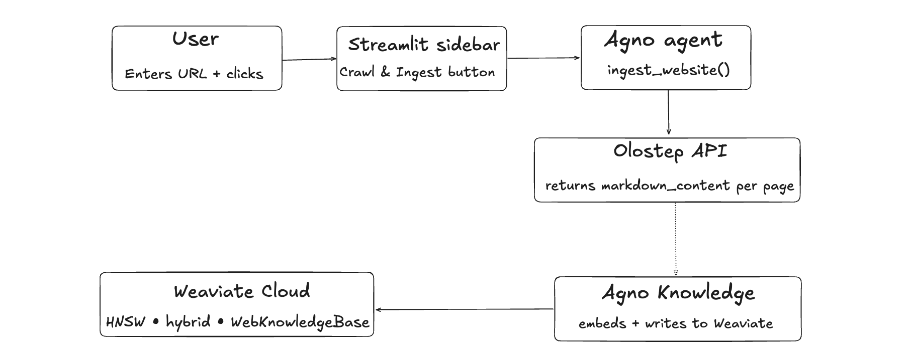
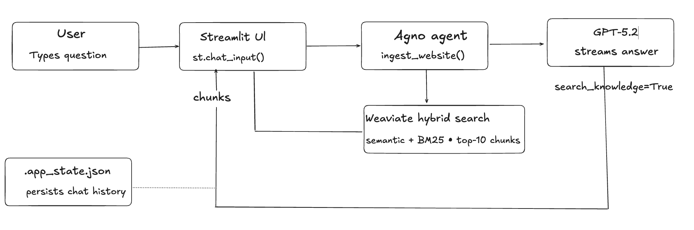

<div align="center">


<br />
<br />

# Website Knowledge Base with Weaviate

### Crawl any website and chat with it using Olostep, Weaviate and Agno

A Streamlit app that crawls a website with Olostep, stores the pages in Weaviate with hybrid search, and answers questions with an Agno agent that cites source URLs.

<br />

[![Built by Studio1](https://img.shields.io/badge/Built_by_Studio1-f97316?style=for-the-badge&logo=data%3Aimage%2Fsvg%2Bxml%3Bbase64%2CPHN2ZyB4bWxucz0iaHR0cDovL3d3dy53My5vcmcvMjAwMC9zdmciIHZpZXdCb3g9IjAgMCAxNjAgMTYwIiBmaWxsPSJub25lIj48cGF0aCBmaWxsLXJ1bGU9ImV2ZW5vZGQiIGNsaXAtcnVsZT0iZXZlbm9kZCIgZD0iTTAgMzVDMCAxNi42ODA3IDE0LjA3NDQgMS42NDg0NCAzMiAwLjEyNjk1M1YxNDFINTEuMDUyM0M1Mi40MzA4IDEzNy4zNDQgNTQuNzQ0NiAxMzMuNjg5IDU3Ljk5MzggMTMwLjAzM0M2MS4xNDQ2IDEyNi41MDggNjQuNjg5MiAxMjMuNDQgNjguNjI3NyAxMjAuODI5QzcyLjU2NjIgMTE4LjM0OSA3Ni4zNTY5IDExNi43ODIgODAgMTE2LjEyOVY4Ni43NTQ0Qzc1LjQ3MDggODcuOTI5MiA3MS4zODQ2IDg5LjY5MTkgNjcuNzQxNSA5Mi4wNDE1QzY0IDk0LjUyMjUgNjAuNzUwOCA5Ny40NiA1Ny45OTM4IDEwMC44NTRDNTYuNTM0NSAxMDIuNzIgNTUuMjU0NSAxMDQuNjU5IDU0LjE1MzkgMTA2LjY3MVYwSDEyNUMxNDQuMzMgMCAxNjAgMTUuNjY5OSAxNjAgMzVWMTI1QzE2MCAxNDQuMzMgMTQ0LjMzIDE2MCAxMjUgMTYwSDEyNFYxOEgxMDQuOTQ4QzEwMy41NjkgMjEuNjgxNiAxMDEuMjU1IDI1LjM2MjggOTguMDA2MiAyOS4wNDQ0Qzk0Ljg1NTQgMzIuNTk0MiA5MS4zMTA4IDM1LjY4NDEgODcuMzcyMyAzOC4zMTRDODMuNDMzOCA0MC44MTIgNzkuNjQzMSA0Mi4zODk2IDc2IDQzLjA0NzRWNzIuNjMwNEM4MC41MjkyIDcxLjQ0NzMgODQuNjE1NCA2OS42NzI0IDg4LjI1ODUgNjcuMzA1N0M5MiA2NC44MDc2IDk1LjI0OTIgNjEuODQ5MSA5OC4wMDYyIDU4LjQzMDdDOTkuNDY1NSA1Ni41NTEzIDEwMC43NDUgNTQuNTk4NiAxMDEuODQ2IDUyLjU3MjNWMTYwSDM1QzE1LjY3IDE2MCAwIDE0NC4zMyAwIDEyNVYzNVoiIGZpbGw9IiNmZmZmZmYiLz48L3N2Zz4K)](https://studio1hq.com)
[](https://weaviate.io)

[Weaviate docs](https://docs.weaviate.io) &nbsp;·&nbsp; [Weaviate](https://weaviate.io) &nbsp;·&nbsp; [More examples](https://github.com/Studio1HQ) &nbsp;·&nbsp; [studio1hq.com](https://studio1hq.com)

</div>

<br />

## Overview

Website Knowledge Base turns a live website into a searchable, AI-powered knowledge base. Enter a documentation site or any URL, and [Olostep](https://www.olostep.com) crawls it into clean Markdown. The pages are stored in [Weaviate](https://weaviate.io) as a hybrid HNSW collection with built-in vector embeddings. An [Agno](https://docs.agno.com) agent answers your questions from that content and cites the source URLs, in a Streamlit chat UI.

Weaviate is the vector store: the agent searches it with hybrid (keyword and semantic) search through Agno's Weaviate integration.

<p align="center"></p>

## Features

- **Crawl any site**: Olostep creates a crawl for a URL, you set the maximum pages (default 20), and the pages come back as Markdown.
- **Hybrid search**: Weaviate stores the pages with cosine distance and an HNSW index, and the agent searches with keyword and semantic matching.
- **Cited answers**: the agent answers strictly from ingested content and cites the source URL of what it uses.
- **Streaming chat**: responses stream into a Streamlit chat interface.
- **Claude Code skills**: the repo includes Weaviate and Olostep skills under `.claude/skills/`.

## Tech stack

| Layer | Tool |
| --- | --- |
| Crawling | [Olostep](https://www.olostep.com) |
| Vector database | [Weaviate Cloud](https://console.weaviate.cloud) |
| Agent framework | [Agno](https://docs.agno.com) |
| LLM | OpenAI `gpt-5.2` |
| UI | [Streamlit](https://streamlit.io) |
| Language | Python 3.11 or later |

## Getting started

### Prerequisites

- Python 3.11 or later
- An Olostep API key from [olostep.com/dashboard/api-keys](https://www.olostep.com/dashboard/api-keys)
- A Weaviate Cloud cluster from [console.weaviate.cloud](https://console.weaviate.cloud) (a free sandbox works)
- An OpenAI API key from [platform.openai.com/api-keys](https://platform.openai.com/api-keys)

### Installation

```bash
git clone https://github.com/Studio1HQ/website-knowledge-base.git
cd website-knowledge-base
pip install -r requirements.txt
```

### Environment variables

Create a `.env` file with your four keys:

| Variable | Description |
| --- | --- |
| `OLOSTEP_API_KEY` | Olostep API key used to crawl sites. |
| `WEAVIATE_URL` | Weaviate Cloud cluster URL. |
| `WEAVIATE_API_KEY` | Weaviate Cloud API key. |
| `OPENAI_API_KEY` | OpenAI API key for the `gpt-5.2` agent. |

### Run

```bash
streamlit run app.py
```

Open <http://localhost:8501>. In the sidebar, enter a URL such as `https://docs.agno.com`, set the maximum pages, and click Crawl & Ingest. When ingestion finishes, ask a question in the chat box.

## How it works

```text
URL -> Olostep crawl -> Markdown pages -> Weaviate (WebKnowledgeBase) -> Agno agent -> Streamlit chat

app.py          Streamlit sidebar and chat UI
agent.py        Agno agent wired to the Weaviate knowledge base
ingest.py       Olostep crawl to Weaviate ingestion
config.py       environment variables and constants
```

1. `ingest.py` starts an Olostep crawl for the URL, collects the Markdown pages, and loads them into the `WebKnowledgeBase` collection in Weaviate.
2. `agent.py` connects to Weaviate Cloud and builds an Agno `Agent` on `gpt-5.2` with `search_knowledge=True`, hybrid search and cosine distance.
3. On each question, the agent searches the collection and streams a Markdown answer that cites source URLs.

<p align="center"></p>

## Resources

- [Weaviate docs](https://docs.weaviate.io) and [site](https://weaviate.io): vector database and hybrid search.
- [Olostep](https://www.olostep.com): web crawling API.
- [Agno docs](https://docs.agno.com): agent framework and Weaviate knowledge integration.

<br />

---

<div align="center">

<a href="https://studio1hq.com">
  <picture>
    <source media="(prefers-color-scheme: dark)" srcset="https://raw.githubusercontent.com/Studio1HQ/website/main/brand/studio1-logo-on-dark.svg" />
    
  </picture>
</a>

Built by **[Studio1](https://studio1hq.com)**, the technical content and DevRel partner for devtool teams. Made with [Weaviate](https://weaviate.io).<br />
Browse more open-source examples at [github.com/Studio1HQ](https://github.com/Studio1HQ).

[](https://studio1hq.com)
[](https://cal.com/studio1/collab)
[](https://x.com/Studio1HQ)
[](https://www.linkedin.com/company/studio1hq/)

<sub><a href="https://studio1hq.com">studio1hq.com</a> · Technical content, docs, video and DevRel for devtools</sub>

</div>
